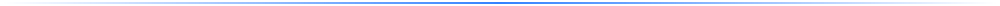

 
 

<a href="./README.md">🇬🇧 English</a> &nbsp;·&nbsp; <strong>🇫🇷 Français</strong>

 
 

 

## 👋 Salut, moi c'est Gabin

Ingénieur du numérique spécialisé en **cybersécurité**, basé en **France**. J'aime comprendre comment les choses fonctionnent, puis les reconstruire à ma façon : une appli web, une boîte à outils pour streamers, ou un homelab qui fait tourner toute ma stack à la maison.

- 🎓 &nbsp;**Diplôme d'ingénieur du numérique**, spécialité Cybersécurité — formation labellisée **SecNumEdu** par l'ANSSI
- 🔐 &nbsp;**DevSecOps** — c'est une grosse partie de ce que je fais : la sécurité pensée dès le pipeline, pas ajoutée à la fin
- 🏠 &nbsp;**Homelab** — des ZimaBoard et un Raspberry Pi 4, du Docker, et un OS optimisé aux petits oignons ([la doc est en ligne](https://homelab.gabin-simond.fr))
- 🧩 &nbsp;**Touche-à-tout** — TypeScript, JavaScript, Bash, selon ce que le projet demande
- 📝 &nbsp;**Je documente ce que je construis** — parce qu'un projet sans doc est un projet qu'on refait
- 🌐 &nbsp;Tout le reste est sur **[gabin-simond.fr](https://gabin-simond.fr)**

## 🛠️ Ma boîte à outils

Ce que j'utilise vraiment dans mes projets et sur mon homelab.

<table>
  <tr>
    <td valign="top"><strong>Langages</strong></td>
    <td>
      
      
      
    </td>
  </tr>
  <tr>
    <td valign="top"><strong>Web &amp; apps</strong></td>
    <td>
      
      
      
      
      
    </td>
  </tr>
  <tr>
    <td valign="top"><strong>Infra &amp; homelab</strong></td>
    <td>
      
      
      
      
      
      
      
      
    </td>
  </tr>
  <tr>
    <td valign="top"><strong>Sécurité &amp; DevSecOps</strong></td>
    <td>
      
      
      
      
      
      
    </td>
  </tr>
  <tr>
    <td valign="top"><strong>Observabilité &amp; CI/CD</strong></td>
    <td>
      
      
      
    </td>
  </tr>
</table>

## 🚀 Projets

<table>
  <tr>
    <td width="50%" valign="top">
      <h3>🎯 <a href="https://petanque.gabin-simond.fr/">Pétanque Concours</a></h3>
      
Gestion de concours de pétanque en SaaS multi-clubs, avec un mode hors-ligne complet : tirages, poules, tableaux et scores fonctionnent sans réseau au boulodrome, puis se synchronisent.

      
      
      
    </td>
    <td width="50%" valign="top">
      <h3>📺 <a href="https://gabinsmd.github.io/StreamBox/index.html">StreamBox</a></h3>
      
Une boîte à outils gratuite et open source pour streamers : chat multi-plateformes, alertes, objectifs, sondages, giveaways, timer de subathon… en overlays OBS, sans rien installer ni compte à connecter.

      
      
      
    </td>
  </tr>
  <tr>
    <td width="50%" valign="top">
      <h3>💃 Ecole SAAS</h3>
      
Un SaaS de gestion d'école de danse.

      
      
    </td>
    <td width="50%" valign="top">
      <h3>🔗 <a href="https://ffd.gabin-simond.fr">FFD Connect</a></h3>
      
Une application indépendante de danse sportive, en bêta ouverte sur iPhone et Android : licence consultable sans réseau, programme des compétitions, musique d'entraînement par danse et gestion des membres du club. Non affiliée à la Fédération Française de Danse.

      
      
      
      
    </td>
  </tr>
  <tr>
    <td colspan="2" valign="top">
      <h3>🏠 <a href="https://homelab.gabin-simond.fr">Documentation Homelab</a></h3>
      
Le journal de bord public de mon homelab : architecture, services auto-hébergés, durcissement, observabilité et runbooks — de quoi tout reconstruire de zéro.

      
      
      
      
      
    </td>
  </tr>
</table>

## 📫 Me contacter

Une idée, une question, un projet ? Le plus simple est de passer par mon site.

 
 

Fait avec ☕ et un homelab qui ne dort jamais.

