 
 

 

## 👋 Salut, moi c'est Gabin

Ingénieur du numérique spécialisé en **cybersécurité**, basé en **France**. J'aime comprendre comment les choses fonctionnent, puis les reconstruire à ma façon : une appli web, un jeu de plateau en Java, ou un homelab qui fait tourner toute ma stack à la maison.

- 🎓 &nbsp;**Diplôme d'ingénieur du numérique**, spécialité Cybersécurité — formation labellisée **SecNumEdu** par l'ANSSI
- 🔐 &nbsp;**DevSecOps** — c'est une grosse partie de ce que je fais : la sécurité pensée dès le pipeline, pas ajoutée à la fin
- 🏠 &nbsp;**Homelab** — des ZimaBoard et un Raspberry Pi 4, du Docker, et un OS optimisé aux petits oignons
- 🧩 &nbsp;**Touche-à-tout** — TypeScript, Java, JavaScript, selon ce que le projet demande
- 📝 &nbsp;**Je documente ce que je construis** — parce qu'un projet sans doc est un projet qu'on refait
- 🌐 &nbsp;Tout le reste est sur **[gabin-simond.fr](https://gabin-simond.fr)**

## 🛠️ Ma boîte à outils

## 🚀 Projets

<table>
  <tr>
    <td width="50%" valign="top">
      <h3>🎯 <a href="https://petanque.gabin-simond.fr/">Pétanque Concours</a></h3>
      
Gestion de concours de pétanque en SaaS multi-clubs, avec un mode hors-ligne complet : tirages, poules, tableaux et scores fonctionnent sans réseau au boulodrome, puis se synchronisent.

      
      
      
    </td>
    <td width="50%" valign="top">
      <h3>📺 <a href="https://gabinsmd.github.io/StreamBox/index.html">StreamBox</a></h3>
      
Une boîte à outils gratuite et open source pour streamers : chat multi-plateformes, alertes, objectifs, sondages, giveaways, timer de subathon… en overlays OBS, sans rien installer ni compte à connecter.

      
      
      
    </td>
  </tr>
  <tr>
    <td width="50%" valign="top">
      <h3>🎓 Ecole SAAS</h3>
      
Une plateforme SaaS de gestion d'école.

      
      
    </td>
    <td width="50%" valign="top">
      <h3>🔗 FFD Connect</h3>
      
Un projet en cours de développement.

      
    </td>
  </tr>
  <tr>
    <td width="50%" valign="top">
      <h3>🏠 <a href="https://github.com/GabinSMD/homelab-doc">homelab-doc</a></h3>
      
La documentation de mon homelab sur Raspberry Pi 4 : stack Docker, optimisations de l'OS et architecture.

      
      
      
    </td>
    <td width="50%" valign="top">
      <h3>🏰 <a href="https://github.com/GabinSMD/citadelles">citadelles</a></h3>
      
Le jeu de société Citadelles, réimplémenté en Java.

      
      
    </td>
  </tr>
</table>

## 📫 Me contacter

Une idée, une question, un projet ? Le plus simple est de passer par mon site.

 
 

Fait avec ☕ et un homelab qui ne dort jamais.

